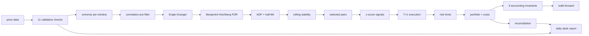

# StatArb Desk Engine

Cointegration research, walk-forward backtesting and desk monitoring for equity
pairs trading.

---

> ## ⚠️ Read this before reading any number in this repository
>
> **All performance figures here were produced on synthetic data.** The build
> environment had no market-data egress (Yahoo and Stooq both return HTTP 403),
> so the pipeline was exercised against a labelled synthetic market generated
> from an Ornstein-Uhlenbeck process.
>
> The strategy assumes spreads mean-revert. The generator makes spreads that
> mean-revert. **Measuring profitability under your own assumptions tests the
> implementation, not the hypothesis.** The Sharpe ratio below is an artifact
> of that setup and is not a performance claim.
>
> What the synthetic run *does* establish: the accounting reconciles, the
> invariants hold, the research funnel recovers pairs it was designed to
> recover and rejects decoys it was designed to reject, and the monitoring
> layer fires on deliberately injected faults. Those claims survive the data
> being fake.
>
> Real-market metrics are marked `NOT YET MEASURED`. See
> [`reports/research_audit.md`](reports/research_audit.md).

---

## What this is

A research platform, not a strategy. It answers "is this pair relationship
real, does the backtest reconcile, and would I know if the data broke" rather
than "how much money does this make".



## Measured results

All figures below came from an actual run. Nothing is estimated.

### Engineering (independent of the data being real)

| metric | measured |
|---|---|
| backtest engine speedup | **2.39×** (433ms → 181ms), output **bit-identical** to the reference implementation |
| tests | **73 passing** |
| accounting invariants | **9/9 pass** on every window |
| data validation checks | 11 |
| reconciliation break types | 6 |
| injected faults detected | **12/12** |
| walk-forward windows | 6 (2016–2025) |
| dataset | 60 symbols × 2,515 sessions = 150,900 observations |

### Research funnel (window 0, training data only)

| stage | surviving |
|---|---|
| universe eligible | 60 |
| all possible pairs | 1,770 |
| correlation ≥ 0.6 | 78 |
| cointegration tests run | 78 |
| naive p < 0.05 | 43 |
| BH-FDR q < 0.05 | 34 |
| residual ADF p < 0.05 | 34 |
| half-life in [2, 60]d | 34 |
| stability ≥ 50% | 18 |
| **selected** | **18** |

Under a complete null, 78 tests at α = 0.05 would produce ~3.9 false positives.

**Scored against known ground truth: decoy admission rate 0.0** — zero of the
12 decoys engineered to have *higher* correlation than the true pairs (0.867 vs
0.817) were admitted.

### Performance — SYNTHETIC, not a claim

| metric | synthetic value | real-market |
|---|---|---|
| Sharpe | 3.52 | `NOT YET MEASURED` |
| CAGR | 6.68% | `NOT YET MEASURED` |
| cumulative return | 47.3% | `NOT YET MEASURED` |
| max drawdown | −1.02% | `NOT YET MEASURED` |
| hit rate | 79.0% | `NOT YET MEASURED` |
| trades | 491 over 1,506 days | — |


### Ablations — including the ones that went wrong

| configuration | pairs | trades | cum. return | Sharpe | max DD | peak gross % |
|---|---|---|---|---|---|---|
| baseline | 10 | 491 | 0.4725 | 3.52 | −1.02% | 100.0 |
| A: correlation only | 20 | 342 | 0.1057 | **1.16** | −1.77% | 104.7 |
| A2: no FDR control | 10 | 505 | 0.4815 | 3.50 | −1.02% | 100.0 |
| B: no stability screen | 20 | 876 | 0.8332 | **3.98** | −2.08% | 103.8 |
| C: gross of costs | 10 | 491 | 0.5163 | 3.79 | −1.00% | 100.0 |
| D: rolling hedge ratio | 10 | 216 | 0.0327 | **0.23** | −4.08% | 109.7 |
| E: no risk limits | 10 | 492 | 0.4777 | 3.54 | −1.02% | **110.6** |


**Three of these did not go as predicted, and that is the most useful part of
the study:**

- **A2 (FDR) is a null result.** Removing multiple-testing correction changed
  nothing measurable. In this generator true pairs have median p = 0.0044 and
  decoys median p = 0.2924, so the populations barely overlap and a raw α cut
  already separates them. The ablation cannot measure FDR's value; it is
  insurance for the regime where signal and noise overlap, which is real
  markets.
- **B (stability) falsified the hypothesis** — removing the screen *improved*
  Sharpe. The ablation is confounded by breadth: the screen halves the book
  from 20 pairs to 10, and max drawdown correspondingly doubled. Isolating the
  screen requires holding pair count fixed. **That experiment has not been
  run.**
- **D (rolling beta) collapsed performance** because the generator uses a
  **constant β**, so rolling re-estimation adds pure variance to a parameter
  that never moves. A clean bias-variance demonstration that says nothing about
  real markets, where betas do drift.

**E is the cleanest result:** risk limits cost 0.5pp of return and 0.01 of
Sharpe, while capping peak gross exposure at exactly 100.0% versus 110.6%.
Cheap in the mean, binding in the tail — which is the actual argument for
limits.

### Transaction cost sensitivity

| round-trip bps | Sharpe | cumulative return | trades |
|---|---|---|---|
| 0 | 3.79 | 0.5163 | 491 |
| 2 | 3.61 | 0.4870 | 491 |
| 5 | 3.34 | 0.4441 | 491 |
| 10 | 3.16 | 0.3832 | 400 |
| 20 | 2.50 | 0.2732 | 290 |
| 40 | 1.77 | 0.1709 | 192 |

No breakeven within the tested range. Note the trade count falling from 491 to
192: the walk-forward re-optimises to trade less frequently as costs rise,
which is the behaviour you want and is not hard-coded anywhere.


### Failure injection

12 faults injected, 12 detected: missing symbol, duplicate rows, stale feed,
corrupt price, negative price, missing fill, duplicate fill, quantity mismatch,
symbol mismatch, price deviation, drawdown breach, gross exposure breach.

The stale-feed case initially came back **MISSED** and exposed a real gap: a
30-day frozen feed counts as *one* stale run, so it only raised a WARNING.
Severity now scales with run length, because 30 frozen days silently zero out
30 days of returns and every beta computed from them.

## Quick start

```bash
pip install -e .
make all                 # synth -> validate -> research -> backtest -> monitor -> report
```

Or step by step:

```bash
python -m statarb.cli synth       # generate the labelled synthetic market
python -m statarb.cli validate    # 11-check data health report
python -m statarb.cli research    # pair selection funnel, scored against ground truth
python -m statarb.cli backtest    # 6-window walk-forward
python -m statarb.cli monitor     # daily desk health report
python -m statarb.cli failures    # failure injection demo
python -m statarb.cli ablations   # ablation study + cost sweep
python -m statarb.cli report      # assemble figures and reports
pytest                            # 73 tests
```

### Running on real data

```bash
pip install '.[market]'
# set data.source: yahoo in config/default.yaml
python -m statarb.cli download
make all
```

The `YahooSource` adapter is implemented but **was never executed** — there was
no network path to test it. Treat its first run as unverified.

## Documentation

| document | contents |
|---|---|
| [`reports/research_audit.md`](reports/research_audit.md) | leakage, bias and validity audit; where evidence contradicted hypothesis |
| [`docs/methodology.md`](docs/methodology.md) | the statistical procedure, stage by stage |
| [`docs/architecture.md`](docs/architecture.md) | module map and design decisions |
| [`docs/project_decisions.md`](docs/project_decisions.md) | every bug found, why it mattered, what changed |
| [`docs/interview_guide.md`](docs/interview_guide.md) | how to describe this without overclaiming |
| [`docs/limitations.md`](docs/limitations.md) | what would have to be true for the results to be trusted |
| [`reports/resume_metrics.md`](reports/resume_metrics.md) | metrics split into safe-to-claim and not |

## Layout

```
src/statarb/
  data/         calendar, synthetic generator, validator, cleaner, storage, downloaders
  research/     stationarity, hedge ratios, cointegration, FDR, stability, selection, ablations
  signals/      spread, z-score, entry/exit state machine
  backtest/     costs, execution delay, portfolio, engine, invariants, walk-forward
  risk/         limits, exposure, performance metrics
  monitoring/   alerts, data health, strategy health, reconciliation, failure injection
  reporting/    analytics, figures, report assembly
tests/          73 tests across data, statistics, signals, backtest, accounting, reconciliation
```

## License

MIT
