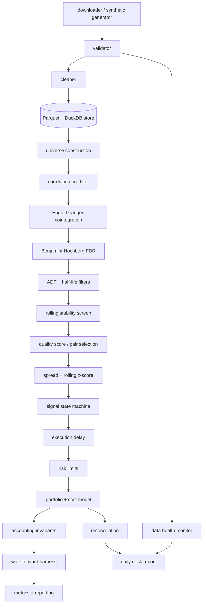

# Architecture

## Layering

Data flows one way. Nothing downstream writes back upstream, and only the
cleaner is permitted to mutate a price panel.

## Module map

| package | responsibility |
|---|---|
| `statarb.data` | calendar, synthetic generator, validation, cleaning, loading, Parquet/DuckDB storage, download adapters |
| `statarb.research` | stationarity, hedge ratios, mean reversion, multiple testing, cointegration, correlation, universe, stability, pair selection, ablations |
| `statarb.signals` | spread construction, rolling z-score, entry/exit state machine |
| `statarb.backtest` | costs, execution delay, portfolio, engine, accounting invariants, walk-forward |
| `statarb.risk` | position limits, exposure, performance metrics |
| `statarb.monitoring` | alerts, data health, strategy health, reconciliation, failure injection |
| `statarb.reporting` | post-trade analytics, figures, report assembly |

## Design decisions worth defending

**Two backtest inner loops.** `_loop_reference` is pandas-indexed and reads
like the specification. `_loop_fast` is NumPy arrays and is the default. They
share setup, sizing, liquidation and all invariants, and `test_fast_and_
reference_engines_agree` asserts bit-identical trades and equity. The reference
loop is the executable definition of correct; the fast loop is what runs. This
is the only reason the 2.39× speedup is a trustworthy claim rather than an
assertion that the rewrite didn't break anything.

**Research cached by `(window_index, selection_mode)`.** Pair selection does
not depend on strategy parameters, so a parameter sweep must not re-run
cointegration testing. This is what makes the ablation study affordable:
experiments C, D and E reuse the `full` selection, so only A and B pay for
extra research passes.

**The cleaner is the only mutator.** Validation is non-mutating by
construction, so a check can never accidentally repair the thing it is
measuring. `forward_fill_limit` defaults to 0 because filling a gap creates a
fake zero return, which then propagates into every beta and z-score computed
from it.

**Invariants are separate from metrics.** `statarb.risk.metrics` computes
performance. `statarb.backtest.accounting` verifies the books. A metric being
attractive and a metric being correct are different properties and are checked
by different code.

**Pre-trade limits vs mark-to-market drift are distinct.** The first is a hard
invariant enforced at fill time. The second is an unavoidable consequence of
prices moving between bars and is reported as a monitoring statistic. Merging
them would either produce false alarms or hide real breaches.
